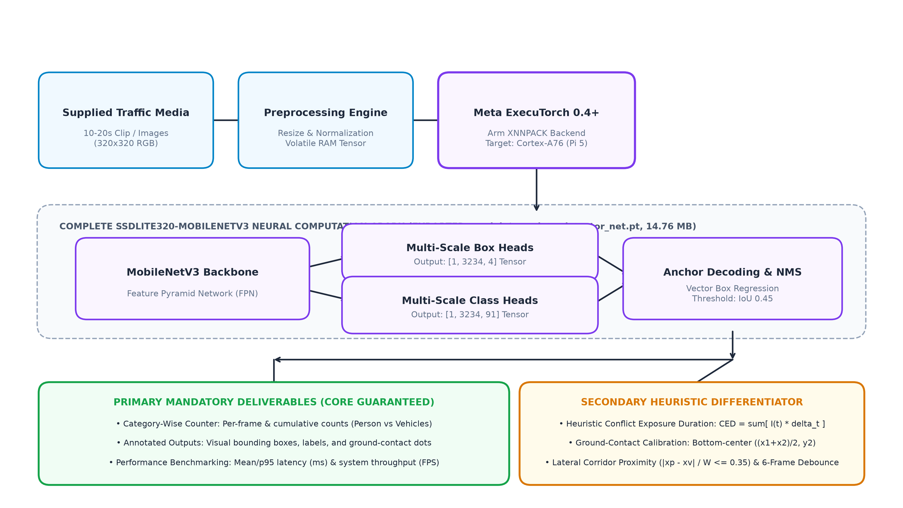

# AegisEdge — Master Submission Document
**Namma AI Hackathon 2026**  
**Track:** Problem Statement 2 — AI for Safer Communities: Edge-Based Object Detection and Counting  
**Organizers:** Nasscom CoE – IoT & AI | Arm | IIIT Bangalore | Supported by UK-India Technology Security Initiative  
**System Architect & Contributor:** [Dharshantech17](https://github.com/Dharshantech17) (`dharshanselva2006@gmail.com`)  
**Target Hardware:** Raspberry Pi 5 (Quad Cortex-A76 @ 2.4 GHz) | **Runtime:** Meta ExecuTorch 0.4+ with Arm XNNPACK (Neon SIMD)

---

### 🏛️ System Architecture & Data Flow Pipeline

*Figure 1: AegisEdge End-to-End Pipeline — Ephemeral Ingestion, ExecuTorch Detection Core, Ground-Contact Mapping & Conflict Analytics.*

---

### ☁️ Master Google Drive Submission Folder

> [!IMPORTANT]
> ### 🔗 **[Click Here to Open Master Google Drive Folder](https://drive.google.com/drive/folders/1TI-24bI7EP6mereBzB6yHRrzYKseYXGi?usp=sharing)**
> **Direct URL:** `https://drive.google.com/drive/folders/1TI-24bI7EP6mereBzB6yHRrzYKseYXGi?usp=sharing`
> 
> **Hosted Deliverables in this Drive Folder:**
> * 🎥 **High-Quality Demo Video:** `AegisEdge_HighQuality_Demo.mp4` (720p HD, 60.00s Operations Dashboard with HUD telemetry, 20.72 MB)
> * 🧠 **Complete Model Binary:** `complete_detector_net.pt` (14.76 MB PyTorch 2.x ExportedProgram for ExecuTorch)
> * 📊 **Machine-Readable Telemetry:** `benchmark_report.json` (100-frame raw latency, FPS & counting error telemetry, 74.4 KB)
> * 📄 **Academic Proposal Document:** `AegisEdge_Project_Proposal_PS2.pdf` (7-Page Proposal Document, 2.74 MB)
> * 📈 **Executive Deck & Benchmarks:** `AegisEdge_Executive_Deck_and_Benchmarks.pdf` (5-Page Empirical Validation Dossier, 560.9 KB)
> * 🖼️ **Sample Detection Outputs:** `sample_output_1_detection_hud.jpg` (184 KB) and `sample_output_2_municipal_report.jpg` (225 KB)

---

### 💻 Public GitHub Repository (Source Code & Scripts)

* 🔗 **Repository URL:** [https://github.com/Dharshantech17/AegisEdge](https://github.com/Dharshantech17/AegisEdge)
* Contains full Python/ExecuTorch export pipeline (`export/export_detector.py`), automated 100-frame latency benchmark harness (`benchmarks/run_benchmark.py`), test media generators, and complete documentation.
