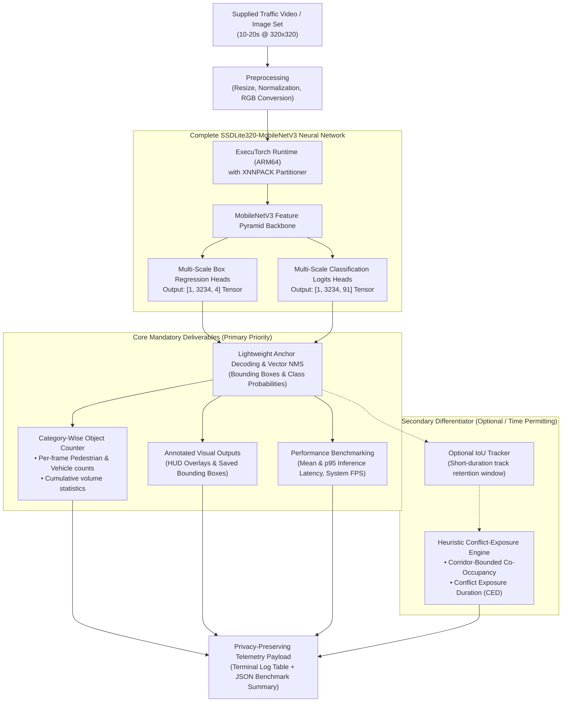

# Stage 1 Project Proposal: Namma AI Hackathon 2026

## 1. Project Identity & Challenge Alignment

* **Project Title:** **AegisEdge: Privacy-Preserving Edge AI for Pedestrian and Vehicle Counting with Crosswalk Conflict-Exposure Analytics**
* **Project Subtitle:** An Arm-based, on-device vision system for category-wise detection and counting of vulnerable road users and vehicles, featuring a heuristic crosswalk conflict-exposure indicator.
* **Challenge Track:** **Problem Statement 2 — AI for Safer Communities: Edge-Based Object Detection and Counting**
* **Organizers:** Nasscom CoE – IoT & AI, Arm, and IIIT Bangalore (Supported by the UK-India Technology Security Initiative)
* **Primary Target Hardware:** **Raspberry Pi 5 (Arm Cortex-A76, 4GB/8GB, 64-bit OS)**
* **Fallback Hardware:** Raspberry Pi 4 Model B (Arm Cortex-A72, 4GB)
* **Core Runtime:** **Meta ExecuTorch** with **Arm XNNPACK Backend**
* **Repository:** `https://github.com/Dharshantech17/AegisEdge`

---

## 2. Problem Statement & Societal Grounding

Public spaces, municipal roads, and community crosswalks require affordable, low-power methods to monitor pedestrian and vehicle movement patterns without relying on expensive server infrastructure or continuous cloud bandwidth.

In urban community environments—such as school zones, transit stops, and unsignalized intersections—civic authorities often lack empirical data on how pedestrian crossings interact with vehicular traffic. Traditional CCTV setups streaming continuous high-definition video over cellular networks incur high recurring data costs, introduce network latency, and create potential privacy concerns regarding the cloud storage of citizen video feeds.

**Societal Objective:** To provide municipal and community stakeholders with localized, privacy-preserving traffic exposure intelligence—specifically identifying peak pedestrian activity, vehicle volumes, and shared-zone conflict exposure—using self-contained, low-power edge hardware.

---

## 3. Proposed Solution: Focused Edge AI PoC

In direct alignment with Problem Statement 2, **AegisEdge** is a focused Edge AI proof-of-concept designed to run locally on a **Raspberry Pi 5** using **Meta ExecuTorch**.

The system ingests short video clips (10–20 seconds) or sample image sequences and focuses primarily on the **mandatory competition deliverables**, supported by a lightweight heuristic differentiator:

### A. Primary Objectives (Mandatory Core Deliverables):
1. **On-Device Object Detection:** Detecting target categories (`person` for pedestrians; `car`, `bus`, `truck`, `motorcycle`, `bicycle` for vehicles) using an approved lightweight model lowered via ExecuTorch.
2. **Category-Wise Counting:** Accurate per-frame and cumulative counting of pedestrians and vehicles.
3. **Annotated Outputs:** Saving annotated images/video displaying bounding boxes, class labels, and on-screen count summaries.
4. **Empirical Benchmarking:** Quantifying and reporting average inference latency (ms/frame) and system processing throughput (FPS).

### B. Secondary Value-Add (Heuristic Differentiator):
* **Heuristic Conflict-Exposure Analytics:** A practical, geometric heuristic indicator that flags concurrent carriageway occupancy and calculates **Conflict Exposure Duration (CED)** when pedestrians and vehicles share the crosswalk corridor.
* *Scope Boundary:* This metric is a **heuristic risk indicator**, not an accident-prediction model. Physical traffic-light actuation and 24/7 continuous field operation are explicitly out of scope for this PoC.

---

## 4. Technical Architecture: Complete SSDLite Network

Rather than exporting only the backbone feature extractor, AegisEdge structures the neural network export to encompass both feature extraction and multiscale detection heads, followed by on-device vector post-processing.



### Clarification on Temporal Tracking:
* **Detection & Per-Frame Counting (Core):** Mandatory and fully guaranteed.
* **Temporal Tracking (Optional Enhancement):** Multi-frame IoU tracking is a secondary enhancement that will be incorporated during Stage 2 **if implementation time permits**. If time is constrained, per-frame detection and counting remain the central verified deliverable.
* **Ground-Contact Coordinate Evaluation:** Zone inclusion evaluates the **bottom-center coordinate** $(\frac{x_1 + x_2}{2}, y_2)$ of each detection, representing the approximate physical contact point on the road surface (feet for pedestrians, tires for vehicles).

---

## 5. Main Differentiator: Heuristic Conflict Exposure Duration (CED)

AegisEdge provides a transparent, practical **heuristic indicator** of shared-zone co-occupancy, without claiming to predict collisions or near-misses.

### Heuristic Logic & Formulation:

1. **Conflict Zone Demarcation:** The user defines an active conflict polygon $Z_c$ representing the active carriageway/crosswalk.
2. **Co-Occupancy Indicator:** At frame $t$, the heuristic indicator $\mathbb{I}(t)$ evaluates to 1 if and only if both a pedestrian ground-contact point and a vehicle ground-contact point concurrently occupy $Z_c$ within a normalized lateral crossing corridor ($\frac{|x_p - x_v|}{W_{\text{frame}}} \le 0.35$).
3. **Conflict Exposure Duration (CED):**
   $$CED = \sum_{t=1}^{T} \mathbb{I}(t) \cdot (t_{t+1} - t_t)$$
   Where $(t_{t+1} - t_t)$ is the **source video frame timestamp delta** ($\Delta t = \frac{1}{\text{FPS}_{\text{video}}}$), ensuring exposure duration is physically accurate to the source video and independent of edge inference throughput.
4. **Event Grouping & Debounce Filter:** Consecutive positive overlap frames are grouped into a single interaction event using a 6-frame debounce filter to avoid splitting single interactions due to momentary detection drops.
5. **Conflict Event Rate (CER):**
   $$CER = \left( \frac{N_{\text{overlap events}}}{T_{\text{observation}}} \right) \times 60 \quad [\text{events / minute}]$$

### Example Municipal Crosswalk Report (Illustrative Output):
```text
┌────────────────────────────────────────────────────────────────────────────────────────┐
│                        AEGISEDGE MUNICIPAL CROSSWALK REPORT                            │
│                  (Illustrative values for civic decision-makers)                       │
├──────────────────────────────────────────┬─────────────────────────────────────────────┤
│ Total Pedestrians Observed               │ 124 individuals                             │
│ Total Vehicles Observed                  │ 216 vehicles                                │
│ Conflict-Zone Overlap Events             │ 18 distinct interaction episodes            │
│ Total Conflict Exposure Duration (CED)   │ 42.6 seconds                                │
│ Conflict Event Rate (CER)                │ 3.6 events / minute                         │
│ Mean Pedestrian Waiting Time (Heuristic) │ 14.8 seconds prior to crossing              │
├──────────────────────────────────────────┴─────────────────────────────────────────────┤
│ Municipal Action & Interpretation:                                                     │
│ • Identifies periods with high pedestrian and vehicle shared-zone activity.            │
│ • Provides objective, empirical evidence for authorities to evaluate crosswalk safety. │
└────────────────────────────────────────────────────────────────────────────────────────┘
```

---

## 6. Baseline Validation & Stage 2 Deployment Plan

We clearly separate what has already been validated in development from what is planned for Stage 2 on physical hardware:

| Component / Task | Validated in Development (Host) | Planned for Stage 2 (Raspberry Pi 5) |
| :--- | :--- | :--- |
| **Media Ingestion** | Video (.mp4) and image directory ingestion tested | Ingestion of official organizer test media |
| **Complete Detector Export** | `CompleteSSDLiteNet` graph captured via `torch.export.export` (14.76 MB) | Final `.pte` binary lowered via ExecuTorch XNNPACK |
| **Detection & Visualisation** | Bounding boxes, class labels, and ground-contact dots rendered | Validated against physical camera/display outputs |
| **Category-Wise Counting** | Frame-by-frame pedestrian and vehicle counting verified | Evaluated against ground-truth on challenge media |
| **Benchmarking Engine** | Automated latency and throughput reporting verified | Wall-clock latency & RAM benchmarking on Pi 5 |
| **Optional Tracking & CED** | Baseline IoU tracking and CED formula tested | Tested on challenge video if implementation time permits |

*Status Note: Complete SSDLite computation graph captured (`models/complete_detector_net.pt`, 14.76 MB, verified output tensors `[1, 3234, 4]` and `[1, 3234, 91]`) and baseline inference pipeline validated on the development host. ExecuTorch XNNPACK lowering, INT8 optimisation, and physical Raspberry Pi 5 deployment are planned for Stage 2 validation.*

---

## 7. Hardware Feasibility & Proposed Engineering Targets

We designate the **Raspberry Pi 5 (Arm Cortex-A76 @ 2.4 GHz)** as our primary target platform, utilizing the **Raspberry Pi 4 Model B** as an optional fallback.

### Proposed Engineering Targets vs. Stage 2 Evaluation:
*(All figures below represent proposed engineering targets and hypotheses to be benchmarked on physical hardware, not guaranteed results.)*

| Metric / Parameter | Proposed Engineering Target | Evaluation Method |
| :--- | :--- | :--- |
| **Target Architecture** | Arm Cortex-A76 @ 2.4 GHz (Raspberry Pi 5) | Target platform for live Stage 2 demonstration |
| **Operating System** | 64-bit Raspberry Pi OS (Debian 12 Bookworm) | Required for PyTorch 2.x & ExecuTorch AArch64 runtime |
| **Model Inference Latency** | Target $< 100$ ms per frame | Wall-clock `time.perf_counter()` on Raspberry Pi 5 |
| **System Throughput** | Target $\ge 10$ FPS sustained | Total frame processing rate over 10–20s evaluation clip |
| **Quantized Model Size** | Target $< 20$ MB (INT8 `.pte` binary) | Physical file size of exported ExecuTorch program |
| **Peak RAM Footprint** | Target $< 300$ MB during active inference | Measured via OS memory profiling (`psutil` / `free -m`) |
| **Counting Accuracy (MACE)**| Target $\le 10\%$ error against ground truth | $\text{MACE} = \frac{1}{K} \sum_{i=1}^{K} |N_{\text{GT}, i} - N_{\text{Pred}, i}|$ (Pedestrians & Vehicles reported separately) |
| **Relative Count Error** | Target $\le 10\%$ RCE across test clips | $\text{RCE}_i = \frac{|N_{\text{GT}, i} - N_{\text{Pred}, i}|}{\max(1, N_{\text{GT}, i})} \times 100\%$ |

---

## 8. Privacy-by-Design Methodology

* **Local On-Chip Processing:** All video decoding, preprocessing, and tensor operations run strictly in volatile memory on the Raspberry Pi.
* **No Identity Extraction:** Zero facial recognition, biometric classification, or license plate reading (ANPR) algorithms.
* **No Video Exfiltration:** Raw frames are discarded immediately after feature extraction.
* **Aggregated Metadata Output:** By default, only aggregated numerical counts and exposure telemetry are stored or transmitted. Annotated debug frames are optional and restricted to local validation.

---

## 9. Compliance with Hackathon Deliverables & Roadmap

| Hackathon Requirement | Implementation Plan |
| :--- | :--- |
| **Process 10–20s clip or images** | Ingestion pipeline supporting `.mp4`, `.avi`, and `.jpg`/`.png` directories via OpenCV. |
| **Detect predefined categories** | Detects `person` (pedestrians) and `car`/`bus`/`truck`/`motorcycle`/`bicycle` (vehicles). |
| **Display counts per frame/image** | Formatted terminal output log table + optional annotated frames with class labels and counts. |
| **Report average inference time & FPS** | Machine-readable benchmark report (`benchmark_report.json`) detailing mean latency, p95 latency, and throughput. |
| **Societal Impact context (2 mins)** | Clear presentation narrative focused on municipal crosswalk exposure analytics. |
| **Out-of-Scope Integrity** | Zero cloud server dependencies, no mobile apps, no custom hardware robotics, no 24/7 continuous field claims. |

### Implementation Roadmap:
* **Stage 1 (Current):** Architectural design, complete detector graph export validation (`complete_detector_net.pt`), and test media pipeline verification.
* **Pre-Hackathon Technical Training:** Attendance of official Arm/IIIT-B technical enablement sessions, fine-tuning of ExecuTorch compilation flags for Arm Cortex-A76.
* **Stage 2 / Live Hackathon Phase:** Deployment onto physical Raspberry Pi 5 hardware, execution on organizer-provided test media, ground-truth counting validation, and latency/RAM measurement reporting.
