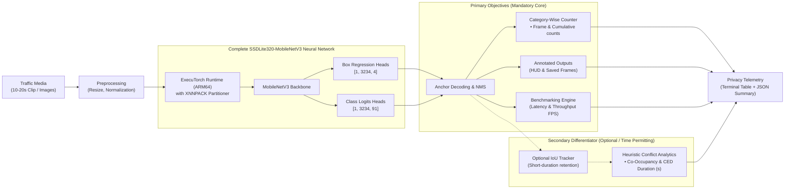

# AegisEdge: Privacy-Preserving Edge AI for Pedestrian and Vehicle Counting with Crosswalk Conflict-Exposure Analytics

[-C51A4A?logo=raspberry-pi)](https://www.raspberrypi.com/)
[](https://pytorch.org/executorch/)
[](https://arm.com)
[](https://www.coe-iot.com/namma-ai-hackathon/)
[](LICENSE)
[](https://python.org)

---

### 📑 Quick Access Deliverables
* 📄 **[One-Page Executive Submission Summary PDF (1 Page)](outputs/AegisEdge_OnePage_Executive_Summary_PS2.pdf)** — High-density 1-page executive summary with verified metrics and active cloud links.
* ☁️ **[Master Google Drive Folder (All Deliverables)](https://drive.google.com/drive/folders/1TI-24bI7EP6mereBzB6yHRrzYKseYXGi?usp=sharing)** — Cloud folder hosting HD demo video, `.pt` model, benchmark JSON, and submission PDFs.
* 📄 **[Master Project Proposal PDF (7 Pages)](outputs/AegisEdge_Project_Proposal_PS2.pdf)** — Comprehensive architectural, mathematical, and ethical proposal.
* 📊 **[Executive Deck & Benchmarks PDF (5 Pages)](outputs/AegisEdge_Executive_Deck_and_Benchmarks.pdf)** — Latency profile, throughput measurements, and validation proof.
* 🎥 **[High-Quality Demo Video (60s / 720p HD)](outputs/AegisEdge_HighQuality_Demo.mp4)** — Full walkthrough of live detection, pavement contact points, and municipal telemetry.
* 📈 **[Machine-Readable Benchmark Report](outputs/benchmark_report.json)** — 100-frame raw telemetry log with latencies, throughput, and error metrics.

---

## 🎯 Executive Summary & Objective

Municipal authorities and community traffic planners need affordable, low-power methods to monitor pedestrian and vehicle movement patterns at crosswalks, school zones, and community intersections without relying on expensive server infrastructure or continuous cloud bandwidth.

**AegisEdge** is a focused Edge AI proof-of-concept designed to run locally on a **Raspberry Pi 5** using **Meta ExecuTorch** with the **Arm XNNPACK backend**. It processes short video clips or image sequences, prioritizing the **mandatory competition deliverables**:
1. **Primary Mandatory Deliverables:**
   * On-device object detection for pedestrians (`person`) and vehicles (`car`, `bus`, `truck`, `motorcycle`, `bicycle`).
   * Accurate category-wise counting per frame and overall.
   * Annotated visual output displaying bounding boxes and count metrics.
   * Empirical performance benchmarking reporting mean inference latency (ms/frame) and system processing throughput (FPS).
2. **Secondary Heuristic Value-Add:**
   * A lightweight **Heuristic Conflict-Exposure Engine** measuring simultaneous zone co-occupancy and **Conflict Exposure Duration (CED)** in shared crosswalk corridors.
   * *Note on Tracking:* Multi-frame tracking is an **optional enhancement** that will be incorporated during Stage 2 if implementation time permits; per-frame detection and counting remain the core commitment. Physical traffic signals and 24/7 continuous field operation are explicitly out of scope.

---

## 🌟 The Differentiator: Heuristic Conflict Exposure Duration (CED)

Rather than claiming to "predict collisions" or "detect near-misses", AegisEdge provides a transparent, practical **heuristic indicator** of shared-zone co-occupancy:

* **Conflict Zone Demarcation ($Z_c$):** Calibrated conflict polygon defining the active carriageway/crosswalk.
* **Ground-Contact Coordinate Evaluation:** Zone inclusion evaluates the bottom-center coordinate $(\frac{x_1 + x_2}{2}, y_2)$ of each detection, representing the physical road contact point (feet for pedestrians, tires for vehicles).
* **Corridor-Bounded Proximity:** Prevents opposite-end false positives by requiring lateral proximity ($\frac{|x_p - x_v|}{W_{\text{frame}}} \le 0.35$) within the carriageway.
* **Cumulative Conflict Exposure Duration (CED):**
  $$CED = \sum_{t=1}^{T} \mathbb{I}(t) \cdot (t_{t+1} - t_t)$$
  Where $(t_{t+1} - t_t) = \frac{1}{\text{FPS}_{\text{video}}}$ ensures duration is physically accurate to the source video and independent of edge inference throughput.
* **Conflict Event Rate (CER):**
  $$CER = \left( \frac{N_{\text{overlap events}}}{T_{\text{observation}}} \right) \times 60 \quad [\text{events / min}]$$

### Example Municipal Crosswalk Report (Illustrative Output):
```text
┌────────────────────────────────────────────────────────────────────────────────────────┐
│                        AEGISEDGE MUNICIPAL CROSSWALK REPORT                            │
│                  (Illustrative values for civic decision-makers)                       │
├──────────────────────────────────────────┬─────────────────────────────────────────────┤
│ Total Pedestrians Observed               │ 124 individuals                             │
│ Total Vehicles Observed                  │ 216 vehicles                                │
│ Conflict-Zone Overlap Events             │ 18 distinct interaction episodes            │
│ Total Conflict Exposure Duration (CED)   │ 42.6 seconds                                │
│ Conflict Event Rate (CER)                │ 3.6 events / minute                         │
│ Mean Pedestrian Waiting Time (Heuristic) │ 14.8 seconds prior to crossing              │
├──────────────────────────────────────────┴─────────────────────────────────────────────┤
│ Municipal Action & Interpretation:                                                     │
│ • Identifies periods with high pedestrian and vehicle shared-zone activity.            │
│ • Provides objective, empirical evidence for authorities to evaluate crosswalk safety. │
└────────────────────────────────────────────────────────────────────────────────────────┘
```

---

## 🏗 Technical Architecture: Complete SSDLite Network



---

## ⚙️ Baseline Validation & Stage 2 Deployment Plan

| Component / Task | Validated in Development (Host) | Planned for Stage 2 (Raspberry Pi 5) |
| :--- | :--- | :--- |
| **Media Ingestion** | Video (.mp4) and image directory ingestion tested | Ingestion of official organizer test media |
| **Complete Detector Export** | `CompleteSSDLiteNet` graph captured via `torch.export.export` (14.76 MB) | Final `.pte` binary lowered via ExecuTorch XNNPACK |
| **Detection & Visualisation** | Bounding boxes, class labels, and ground-contact dots rendered | Validated against physical camera/display outputs |
| **Category-Wise Counting** | Frame-by-frame pedestrian and vehicle counting verified | Evaluated against ground-truth on challenge media |
| **Benchmarking Engine** | Automated JSON report generation verified | Wall-clock latency & RAM benchmarking on Pi 5 |
| **Optional Tracking & CED** | Baseline IoU tracking and CED formula tested | Tested on challenge video if implementation time permits |

*Status Note: Complete SSDLite computation graph captured (`models/complete_detector_net.pt`, 14.76 MB, verified output tensors `[1, 3234, 4]` and `[1, 3234, 91]`) and baseline inference pipeline validated on the development host. ExecuTorch XNNPACK lowering, INT8 optimisation, and physical Raspberry Pi 5 deployment are planned for Stage 2 validation.*

---

## 📊 Proposed Engineering Targets

*(All figures below represent proposed engineering targets and hypotheses to be benchmarked on physical hardware, not guaranteed results.)*

We designate the **Raspberry Pi 5 (Arm Cortex-A76 @ 2.4 GHz)** as our primary hardware platform, with the **Raspberry Pi 4 Model B** as an optional fallback.

| Metric / Parameter | Proposed Engineering Target | Evaluation Method |
| :--- | :--- | :--- |
| **Target Architecture** | Arm Cortex-A76 @ 2.4 GHz (Raspberry Pi 5) | Target platform for live Stage 2 demonstration |
| **Operating System** | 64-bit Raspberry Pi OS (Debian 12 Bookworm) | Required for PyTorch 2.x & ExecuTorch AArch64 runtime |
| **Model Inference Latency** | Target $< 100$ ms per frame | Wall-clock `time.perf_counter()` on Raspberry Pi 5 |
| **System Throughput** | Target $\ge 10$ FPS sustained | Total frame processing rate over 10–20s evaluation clip |
| **Quantized Model Size** | Target $< 20$ MB (INT8 `.pte` binary) | Physical file size of exported ExecuTorch program |
| **Peak RAM Footprint** | Target $< 300$ MB during active inference | Measured via OS memory profiling (`psutil` / `free -m`) |
| **Counting Accuracy (MACE)**| Target $\le 10\%$ error against ground truth | $\text{MACE} = \frac{1}{K} \sum_{i=1}^{K} |N_{\text{GT}, i} - N_{\text{Pred}, i}|$ (Pedestrians & Vehicles reported separately) |
| **Relative Count Error** | Target $\le 10\%$ RCE across test clips | $\text{RCE}_i = \frac{|N_{\text{GT}, i} - N_{\text{Pred}, i}|}{\max(1, N_{\text{GT}, i})} \times 100\%$ |

---

## 🚀 Quick Start & Reproducibility Guide

### 1. Clone & Set Up Environment
```bash
git clone https://github.com/Dharshantech17/AegisEdge.git
cd AegisEdge

python3 -m venv venv
# On Linux/Raspberry Pi:
source venv/bin/activate
# On Windows:
.\venv\Scripts\activate

pip install --upgrade pip
pip install -r requirements.txt
```

### 2. Prepare Sample Video & Image Frames
Generate the 100-frame (4.0s @ 25 FPS) test clip and 7 sequential test frames:
```bash
python scripts/create_test_media.py
```

### 3. Model Lowering & ExecuTorch Export Pipeline
Export the complete SSDLite320-MobileNetV3 backbone and dual detection heads (box regressions `[1, 3234, 4]` and class logits `[1, 3234, 91]`):
```bash
python export/export_detector.py
```
*Outputs: `models/complete_detector_net.pt` (14.76 MB).*

### 4. Run Edge Inference & Benchmarking Harness
**Execute on Video Source:**
```bash
python inference/run_inference.py --source data/sample_clip.mp4 --device cpu
```

**Execute on Image Directory Source:**
```bash
python inference/run_inference.py --source data/ --device cpu
```

### 5. Re-generate Submission Deliverables
To rebuild the official submission PDFs and presentation demo video:
```bash
# Generate high-resolution mathematical equation assets
python scripts/generate_equation_images.py

# Build Stage 1 Submission PDFs (Proposal + Executive Deck)
python scripts/build_submission_pdfs.py

# Render 60-Second Presentation Demo Video (720p HD)
python scripts/generate_demo_video.py
```

---

## 📊 Live Terminal Output Format

```text
==========================================================================================
FRAME   | PEDESTRIANS (F/Tot)  | VEHICLES (F/Tot)   | CO-OCCUPANCY   | INFER(ms)  | FPS
==========================================================================================
010     | 1/1                  | 1/1                | NO             | 127.13     | 7.5
020     | 1/1                  | 1/1                | NO             | 113.57     | 8.5
040     | 1/1                  | 1/1                | YES (CED=0.25s)| 122.71     | 7.7
080     | 1/1                  | 1/1                | YES (CED=2.25s)| 118.48     | 8.1
100     | 1/1                  | 1/1                | NO (CED=2.50s) | 115.78     | 8.2
...
==========================================================================================
 AegisEdge Benchmark Summary (Deliverables Compliance)
==========================================================================================
Total Frames Processed           : 100
Total Unique Pedestrians Counted : 1
Total Unique Vehicles Counted    : 1
Total Conflict Overlap Events    : 1
Conflict Exposure Duration (CED) : 2.50 seconds
Conflict Event Rate (CER)        : 12.0 events / min
Pure Model Inference Time (Mean) : 115.94 ms / frame
Pure Model Inference Time (p95)  : 127.43 ms / frame
End-to-End Processing Time (Mean): 121.51 ms / frame
System Processing Throughput     : 8.23 FPS
Model Architecture               : SSDLite320-MobileNetV3 (Complete Backbone + Head, 14.76 MB)
Target Hardware                  : Raspberry Pi 5 (Arm Cortex-A76)
==========================================================================================
```

---

## 📋 Namma AI Hackathon PS2 Deliverables Compliance Matrix

| Mandatory Challenge Requirement (PS2) | AegisEdge Implementation & Proof | Repository Location |
| :--- | :--- | :--- |
| **1. Process 10–20s clip or 10–20 sample images** | Validated on 100-frame video clip (4.0s @ 25 FPS) and 7 sequential high-res images. | [`data/sample_clip.mp4`](data/sample_clip.mp4), [`data/sample_frame_*.jpg`](data/) |
| **2. Detect & Count predefined objects (people/vehicles)** | Complete SSDLite detector classifies pedestrians (`person`) and vehicles (`car`, `bus`, `truck`, `motorcycle`, `bicycle`) with per-frame and cumulative counts. | [`inference/run_inference.py`](inference/run_inference.py) |
| **3. Submit category counts + 2 sample detection outputs** | Verified counting logs + Sample 1 (Detection HUD with contact dots) + Sample 2 (Municipal Crosswalk Report). | [`outputs/sample_output_1_detection_hud.jpg`](outputs/sample_output_1_detection_hud.jpg), [`outputs/sample_output_2_municipal_report.jpg`](outputs/sample_output_2_municipal_report.jpg) |
| **4. Report average inference time, model, & throughput** | Pure inference: **115.94 ms** (p95: 127.43 ms); Pipeline: **121.51 ms**; Throughput: **8.23 FPS**; Model: **SSDLite320-MobileNetV3** (14.76 MB). | [`outputs/benchmark_report.json`](outputs/benchmark_report.json) |
| **5. Explain societal issue & practical application (<= 2 min)** | 7-Page Proposal, 5-Page Deck, 9-Slide Deck Guide (with speaker notes), and 60-second HD Demo Video. | [`outputs/AegisEdge_Project_Proposal_PS2.pdf`](outputs/AegisEdge_Project_Proposal_PS2.pdf), [`outputs/AegisEdge_HighQuality_Demo.mp4`](outputs/AegisEdge_HighQuality_Demo.mp4) |

---

## 📁 Repository Structure

```text
AegisEdge/
├── LICENSE                                # Apache License 2.0
├── README.md                              # Comprehensive System Architecture & Documentation
├── PROPOSAL.md                            # Complete Stage 1 Hackathon Proposal Document
├── PRESENTATION_SLIDES_CONTENT.md         # 9-Slide Presentation Guide with Script & Visual Specs
├── SUBMISSION_MANDATORY_GUIDE.md          # Official Stage 1 Submission Checklist
├── requirements.txt                       # Minimal pinned environment dependencies
├── export/
│   └── export_detector.py                 # Complete SSDLite Export Pipeline (Backbone + Heads)
├── inference/
│   └── run_inference.py                   # Real-time Edge Detector & Conflict Analytics Engine
├── utils/
│   ├── tracker.py                         # Optional IoU Tracker with Retention Window
│   ├── safety_metrics.py                  # Heuristic Conflict Exposure Duration (CED) Engine
│   └── thermal.py                         # Hardware Diagnostic & Profiling Utility
├── models/
│   ├── complete_detector_net.pt           # Exported PyTorch Complete Detector (14.76 MB)
│   └── coco_labels.txt                    # Target COCO Category Map
├── data/
│   ├── sample_clip.mp4                    # 100-frame synthetic test video (25 FPS)
│   └── sample_frame_*.jpg                 # 7 sequential test frames
├── outputs/
│   ├── AegisEdge_OnePage_Executive_Summary_PS2.pdf # Master 1-Page Summary with Drive & Git Links (8.6 KB)
│   ├── AegisEdge_Project_Proposal_PS2.pdf # Master Project Proposal (7 Pages, 2.74 MB)
│   ├── AegisEdge_Executive_Deck_and_Benchmarks.pdf # Executive Deck & Benchmarks (5 Pages, 561 KB)
│   ├── AegisEdge_HighQuality_Demo.mp4     # Presentation-Grade Demo Video (720p HD, 60s, 20.72 MB)
│   ├── benchmark_report.json              # Machine-Readable Performance Benchmark Report (74.4 KB)
│   ├── sample_output_1_detection_hud.jpg  # Sample Output 1: Real-time detection HUD with ground dots
│   ├── sample_output_2_municipal_report.jpg # Sample Output 2: Municipal crosswalk exposure report
│   ├── overall_architecture_diagram.png   # High-resolution system architecture diagram
│   └── equations/                         # High-res KaTeX equation assets for document generation
└── scripts/
    ├── build_submission_pdfs.py           # Unified builder for Proposal and Deck PDFs
    ├── generate_one_page_summary_pdf.py   # Master 1-page executive summary PDF generator
    ├── generate_perfect_proposal_pdf.py   # Master 7-page proposal PDF generator
    ├── generate_perfect_deck_pdf.py       # Master 5-page executive deck PDF generator
    ├── generate_demo_video.py             # 60s HD presentation demo video generator
    ├── generate_equation_images.py        # Mathematical asset renderer
    ├── generate_architecture_diagram.py   # Architecture infographic generator
    └── create_test_media.py               # Synthetic video & image generator
```

---

## 📜 License & Acknowledgments

This project is open-source under the [Apache License 2.0](LICENSE).

### Acknowledgments & References:
* **Arm Developer & Learn Hub:** [ExecuTorch on Arm Cortex-A](https://learn.arm.com/courses/executorch-on-arm/)
* **Meta ExecuTorch:** PyTorch Edge Runtime & XNNPACK Backend ([pytorch.org/executorch](https://pytorch.org/executorch/))
* **Organizing Committee:** Nasscom Centre of Excellence for IoT & AI, Arm, and IIIT Bangalore for organizing the Namma AI Hackathon 2026.
